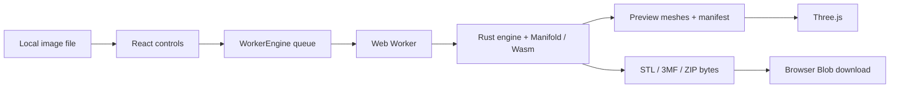

# Relief Studio v2 architecture

The static host serves assets only. `crates/relief-core` also compiles to the
`relief-native` CLI. The Python implementation remains unchanged as the v1
behavioral reference; see [its architecture](architecture-v1.md).

## Ownership

- `settings.rs`: one validated settings boundary with closed enums, numeric
  limits, and cross-field constraints. Callers cannot mutate validated settings.
- `artwork.rs`: bounded PNG/JPEG/WebP decoding and EXIF orientation, restricted
  self-contained SVG rasterization through resvg, opacity/perimeter contrast,
  manual threshold/inversion, nested contour tracing, filtering, and scaling.
  The traced result keeps relief and outer silhouette separate. Contour inversion
  complements the relief within the uninverted silhouette after scaling/cleanup;
  layout uses that retained silhouette, including when the inverted relief is empty.
  Rectangle mode still inverts the raster before tracing. This contour behavior
  intentionally corrects v1's canvas-shaped backing after inversion.
  A bundled DejaVu font supplies offline SVG text; convert text to paths when
  an exact custom typeface matters.
- `layout.rs` / `random.rs`: rounded footprints, outward contour offsets, centered
  loops, complementary puzzle seams, internal clearance, automatic grid choice,
  and Python-compatible integer-seeded MT19937 patterns.
- `geometry.rs` / `solids.rs`: Manifold cross-sections, extrusion, booleans,
  rectangle border lofts, contour height bands, decorative beads, rear mounting,
  and triangle validation after conversion to STL's float32 representation.
  A border joins the artwork or background material, or becomes a third aligned
  part. Any shared volume belongs to the border before materials are separated;
  their union and the finished bounds are independent of the material choice.
  Closed opposite edges, finite coordinates, and positive volume are required.
- `packing.rs`: stable shelf packing with 3 mm gaps, aligned material placement,
  and P1S front-left exclusion-zone checks.
- `exports.rs`: preview DTOs, maps, PNG, source hashes, manifests, aligned STL,
  Bambu two/three-filament 3MF projects, and ZIP packs produced in memory.
- `wasm.rs`: owned-buffer ABI. JavaScript copies results before the next call;
  Rust frees project/kernel resources automatically. Export bytes transfer back
  to the UI without an additional worker-to-main-thread copy.

## Browser lifecycle

`WorkerEngine` permits one active request and retains the newest queued build.
React rejects superseded results and disables downloads while settings are being
edited or generated. Export IDs must identify the current Rust project. Worker
errors/timeouts settle requests; explicit retry starts a fresh worker. Blob URLs
are revoked on edits, replacement exports, and unmount.

The UI owns a workspace document separately from the generated preview. Portable
JSON files embed original source bytes, settings, the project name, and selected
preview tab. Opening replaces these atomically and clears old exports. Optional
IndexedDB recovery stores the latest workspace on this browser only. Neither
path needs a runtime server API. See [workspace files](workspace-files.md).

Rust and C++ compile together using Emscripten, avoiding JavaScript geometry or a
second boolean kernel. The build is single-threaded inside its worker and needs
no cross-origin isolation headers or SharedArrayBuffer. The module starts with
64 MiB and can grow to 2 GiB; browser/device limits may be lower. An allocation
failure or trap produces a recoverable UI error, not an export of partial meshes.

The production build generates a service worker that caches that exact set of
assets, including Wasm and fonts. It never stores artwork. Cache versions wait
for older open clients to close before activation. Localhost/HTTPS is required;
initial loading and building are distinct from subsequent offline operation.

## Compatibility and limits

The 33-case v1 corpus checks acceptance, grids, piece IDs/counts, plate counts,
material parts, extents, area, and volume. Independent Trimesh/XML/ZIP checks load
every generated STL and 3MF in the corpus. Native invariant tests cover selection
boundaries, complementary seams, clearance, mounting, and failure recovery.
Browser tests exercise the existing controls at desktop/mobile sizes, plus
worker recovery, offline reload/import/export, and the 64-piece boundary.

The renderers and curve/sphere tessellation differ from v1. Tiny antialiased
regions can differ; geometric comparisons use stated millimeter/volume bounds.
Synthetic nested holes retain exact topology. The existing 12 MiB input, 24 MP
raster, 5,000-region, and 64-piece limits remain. Physical joint fit, mounting
strength, actual AMS tray assignment, and final slicing still require inspection.

Build decisions and migration reference: [browser v2](browser-v2.md).
